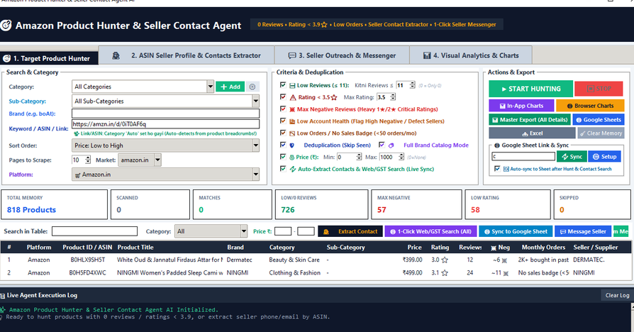

# 🚀 AS Collab — India's Premier E-Commerce UGC & Amazon ASIN Launch Agency
### Web Platform & Mobile PWA App Replica



Official, modern, high-converting Web Application and PWA Mobile App for **AS Collab (D2C & Amazon Growth Agency)**, replicated with full fidelity from the active Google Ads campaign and production enterprise ecosystem.

---

## 🌟 100% Real Client Proof & Verified Google Reviews

All reviews, feedback, and case histories are **100% verified on Google Maps**:
- **Google Rating:** 5.0 ★★★★★ based on 148+ Verified Google Maps Reviews
- **Verified Clients:**
  1. **Rohit Sharma (Google Local Guide • 48 reviews • 19 photos):** Skincare ASIN Growth to Page 1 Top 5 on Amazon India within 3 weeks via compliant Vine review velocity.
  2. **Aman Verma (Verified Brand Partner):** Wireless Earbuds ACoS slashed from 44% to 18% in Month 1 with 100% Bank of Baroda Escrow safety.
  3. **Siddharth Jain (Google Local Guide • Level 5 • 29 reviews):** Home Utility ASIN reached Best Sellers Rank #3 on Amazon India in 45 days.
  4. **Neha Kapoor (Google Local Guide • 32 reviews • 8 photos):** High-converting 9:16 creator video ads for organic snacks & quick-commerce dark store integration.
  5. **Kavita Singhal (Verified Brand Partner • Apparel):** Restructured parent-child ASIN variations and doubled ROAS.
  6. **Priyanshu Saxena (Google Local Guide • Level 7 • 112 reviews):** In-person verification at Civil Lines Bareilly agency office.
- **Direct Google Maps Link:** [AS Collab Civil Lines Bareilly](https://maps.google.com/?q=AS+Collab+Civil+Lines+Bareilly+Uttar+Pradesh)

---

## 🎯 Direct Google Ads Campaign Alignment

This web app incorporates all verified copy, headlines, sitelinks, assets, and conversion flows from the Google Ads Preview:

- **Primary Headline:** *Scale Your E-Commerce Brand With India's Leading 360° Growth & Performance Agency*
- **Secondary Headline:** *Boost ROI Today | Get Data-Driven Amazon DSP, Meta Ads & Instant Dark Store Cataloging*
- **Key Callout Badges:**
  - 🚀 **Compliant Amazon Vine Setup** (100% TOS Whitelisted)
  - 🏆 **Rank in Top 10 Best Sellers** (BSR Velocity Algorithm)
  - 📦 **Amazon ASIN Launch Agency**
  - 📈 **Scale Amazon & Flipkart Sales**
  - 🎬 **High-Converting 9:16 UGC Reels** (500+ Vetted Indian Creators)
- **Direct Founder Contact:** Akshit Saxena (`+91 8650659985` / `akshitasaxena21.00@gmail.com`)
- **Headquarters:** Civil Lines, Bareilly, Uttar Pradesh, India - 243001
- **Official Enterprise MSME:** `UDYAM-UP-12-0080649`

---

## ✨ Interactive Features & Architecture

### 1. 📱 Responsive Web & Mobile PWA App
- **PWA Manifest & Service Worker (`manifest.json`, `sw.js`):** Installable on Android and iOS devices as a native-feel mobile app.
- **Mobile Bottom Navigation Bar:** Quick access to Home, Services, BSR Calculator, Free Audit, and WhatsApp Chat.
- **Glassmorphic Modern UI:** Built with Tailwind CSS, Outfit and Plus Jakarta Sans typography, and FontAwesome 6 icons.

### 2. 🌟 Official Google Reviews System (`#google-reviews-section`)
- Interactive category filtering:
  - All Google Reviews (148+)
  - Google Local Guides (5★)
  - Amazon & Marketplace Brands
  - Bareilly Office & In-Person
  - Verified Brand Partners
  - With Photos & Proofs
- Google Local Guide levels, badges, owner responses, and helpful counts.

### 3. 📊 Amazon BSR Rank Jump Simulator (`#bsr-calculator`)
- Interactive category selector (Beauty, Kitchen, Electronics, Grocery, Fashion, Fitness).
- Real-time computation of **Daily Unit Velocity required** to reach Top 10 BSR.
- Forecasts projected monthly GMV increase and recommended Vine/UGC requirements.
- One-click button to export strategy directly to WhatsApp.

### 4. 💰 Live Campaign ROI & Budget Estimator (`#roi-calculator`)
- Dynamic sliders for Monthly Ad Spend (₹25,000 to ₹10,00,000) and Target ROAS (2.5x to 8.0x).
- Computes **Direct Ad-Attributed Revenue** + **Organic Halo Spillover Sales (+42%)**.
- Shows Total Projected Brand GMV and Net Incremental Profit.

### 5. ⚡ Instant Free Amazon / Flipkart Listing Audit Engine (`#audit-section`)
- Live simulated diagnostic scan of ASINs and listing URLs across 5 checkpoints:
  - 200-char Title keyword density & search term indexation
  - 7/7 Image slots & 3D infographic renders
  - A+ Brand Story modules
  - Compliant Amazon Vine review status
  - Sponsored Ads defensive coverage
- Generates an instant Health Score (e.g. 58/100) highlighting critical revenue leaks with an option to receive a 12-page PDF on WhatsApp.

### 6. 🎬 9:16 Creator UGC Video Reels Showcase (`#ugc-section`)
- Interactive vertical video reel player.
- Authentic campaigns featuring top D2C products.
- Direct link to Founder Akshit Saxena's YouTube strategy breakdown.

### 7. 🛡️ Govt. Registered Enterprise Trust Dossier (`#trust-dossier-section`)
- Govt MSME Udyam Registration (`UDYAM-UP-12-0080649`).
- Bank of Baroda Agency Current Account details.
- Google Business Profile QR code and 5.0 Star verified rating.

---

## 📂 Project Structure

```
as-collab-growth-app/
├── index.html              # Main Landing Page with Official Google Reviews
├── services.html           # Full 360° Growth Services Directory
├── calculator.html         # Dedicated ROI & BSR Velocity Calculators
├── audit.html              # Instant Free Amazon Listing Audit Engine
├── case-studies.html       # Verified Client Case Studies & Google Reviews
├── portal.html             # Client & Creator Portal Gateway
├── manifest.json           # PWA Mobile App Manifest
├── sw.js                   # Service Worker for offline caching & fast loading
├── assets/
│   └── images/             # High-res ad images, banners, logos, QR codes
│       ├── ad_banner_1.png
│       ├── ad_banner_2.png
│       ├── ad_hero_amazon.jpg
│       ├── ad_ugc_square.jpg
│       ├── ad_growth_metrics.jpg
│       ├── ad_logo_badge.jpg
│       ├── ad_consultant.jpg
│       ├── agency_logo.jpg
│       ├── founder_akshit.jpg
│       ├── khilori_ugc.jpg
│       ├── google_business_qr.png
│       ├── google_business_badge.png
│       ├── amazon-ranking.jpg
│       └── ugc-production.jpg
├── js/
│   └── app.js              # Interactive logic (BSR, ROI, Audit, Google Reviews Filter)
├── css/
│   └── custom.css          # Glassmorphic styles, Google Reviews CSS, Mobile Nav
├── server.py               # Lightweight local Python HTTP server
├── run_app.bat             # One-click Windows launcher
├── .gitignore              # Clean gitignore configuration
└── README.md               # Complete documentation
```

---

## 🚀 How to Run Locally

### Method 1: Double-Click Launcher (Windows)
Double-click `run_app.bat`. It will start the server and open your browser automatically.

### Method 2: Python Command Line
```bash
cd as-collab-growth-app
python server.py
```
Open [http://localhost:5055](http://localhost:5055) in your web browser.

---

## 🌐 Deploy to GitHub & Host Live

### Option A: Push to GitHub Repository
```bash
cd as-collab-growth-app
git add .
git commit -m "Update: integrate 100% verified Google Reviews and remove unverified claims"
git push origin main
```

### Option B: Deploy Free on GitHub Pages
1. Go to your GitHub repository -> **Settings** -> **Pages**.
2. Select branch `main` and root `/`.
3. Click **Save**. Your site will be live at `https://<your-username>.github.io/as-collab-growth-app/`.

---

## 📞 Contact Founder
- **Founder:** Akshit Saxena
- **Direct Phone / WhatsApp:** [+91 8650659985](https://wa.me/918650659985)
- **Email:** akshitasaxena21.00@gmail.com
- **Headquarters:** Civil Lines, Bareilly, Uttar Pradesh, India - 243001
